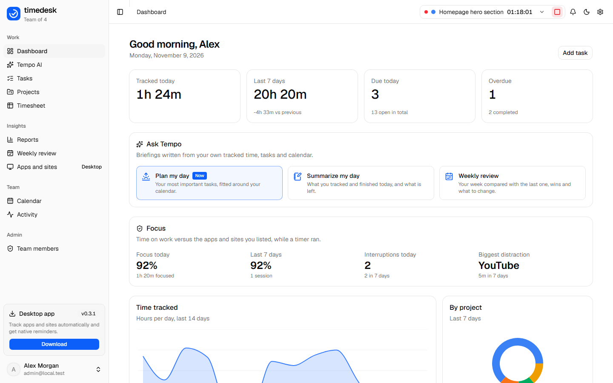
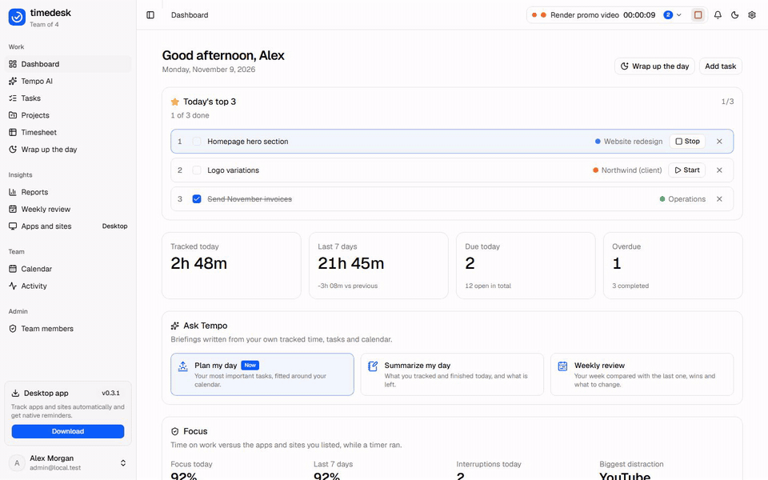
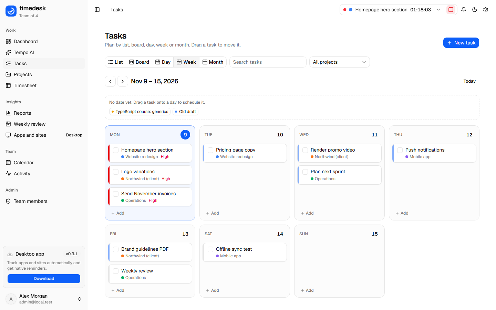
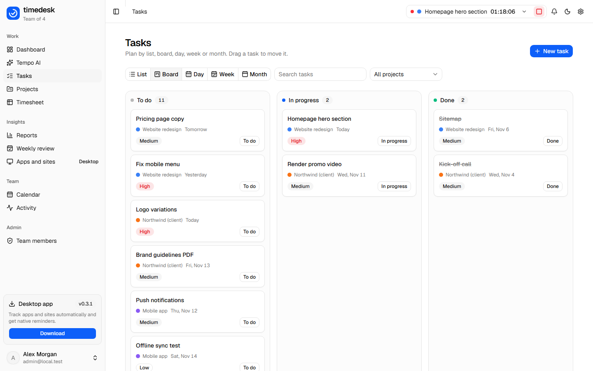
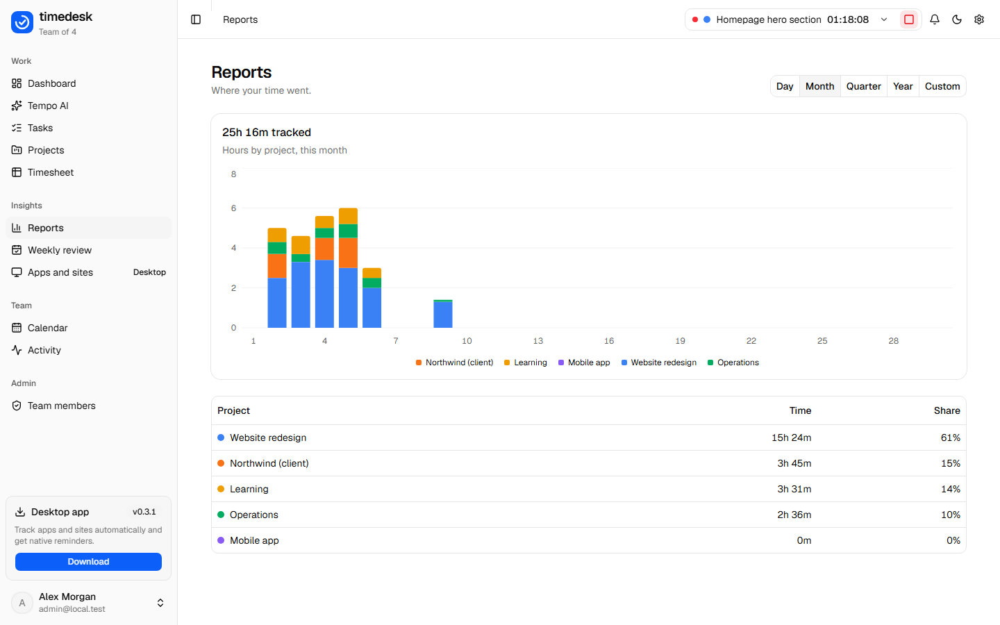
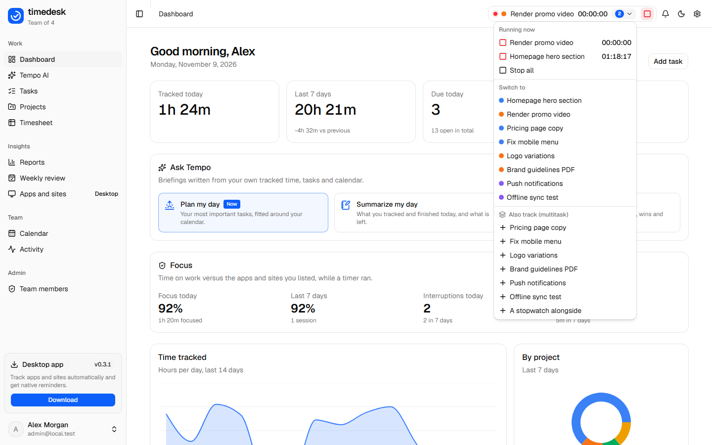
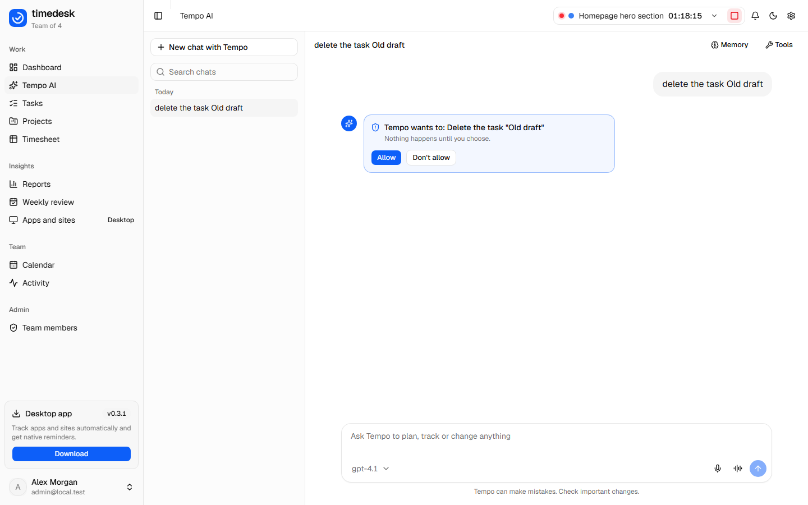
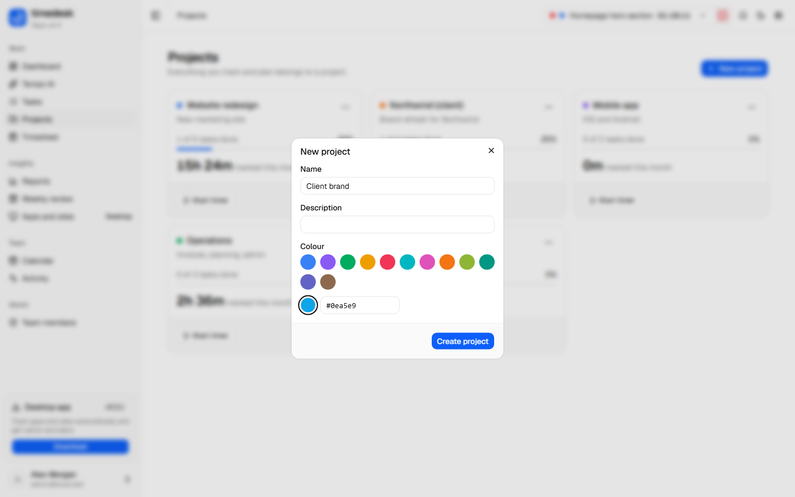
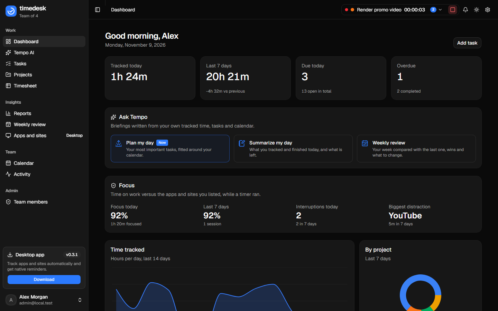

# timedesk

Time tracking, todos and an AI assistant for a small team. One web app, a Windows and Linux desktop app, and a Node API on Neon Postgres.

[](LICENSE)



> Status: version 0.3.1 released, with offline mode, multitasking and Tempo approvals on the `develop` branch. Built for a team of 3 to 5 people. Mobile comes later (see the [roadmap](#roadmap)).

**Works offline.** Start or stop a timer with no internet: it happens at once, waits on your device, and reaches the server with the right times when you are back online.



## What it does

| Area | Features |
|---|---|
| **Plan** | Projects, tasks with status, priority, due date and recurrence (daily, weekly, monthly, custom), due-date groups (overdue, today, tomorrow, this week, later), list, board, day, week and month views, drag and drop to reschedule or change status, edit and delete projects |
| **Track** | Timer in the top bar, stopwatch, weekly timesheet. **Multitasking:** run several timers at once; overlapping time is shared between them, so your day still adds up to the clock |
| **Offline** | Every change is saved on your device first and synced in order when you are online, with the time you really pressed the button. The app opens without a connection. A badge shows what is still waiting |
| **Understand** | Dashboard with charts, reports by day, month, quarter, year and any custom date range, weekly review |
| **Tempo AI** | A chat assistant that works on your real data: it can add and change tasks, manage projects, run the timer and build reports, and write a daily summary, a weekly review or a plan for your day. **It asks before it deletes anything or changes your calendar** (Allow / Don't allow), and asks which one you mean instead of guessing. Bring your own key for OpenAI, Anthropic, Gemini, Groq or xAI Grok. Long-term memory with mem0. Voice mode. Chat history saved in the database |
| **Focus guard** | Desktop: while a timer runs, a gentle nudge when an app or site you listed (YouTube, Discord...) takes over, and a focus score on the dashboard. Window titles never leave your computer |
| **See the timer** | Floating always-on-top timer in four styles (compact, expanded, bottom bar, Pomodoro), the running time in the window title, global shortcuts, quick add from any program, idle check, Ctrl+K command palette |
| **Desktop app** | System tray with the running timer, native notifications and due-date reminders, start with the computer, auto-update, and optional app tracking (which program is in front) that only you can see |
| **Team** | Sign-up with username, email and password. **An admin approves every new account.** Everyone's data is private to them |
| **Calendar** | Optional two-way **Google Calendar**: see your events beside your tasks, add, edit and delete events, tasks with a due date appear in Google as all-day events and moves or renames made in Google come back. Set up in [docs/DEPLOY.md](docs/DEPLOY.md) |
| **Look** | shadcn UI, light and dark mode, six accent colours, radius, font, text size and sidebar style, all saved to your account. Projects in 12 preset colours or any colour you pick |
| **Your data** | Download everything as JSON or your time as CSV, and delete your account |

## Screenshots

| | |
|---|---|
|  |  |
| **Plan:** day, week and month views, drag a task to another day | **Board:** drag a card to change its status |
|  |  |
| **Reports:** by day, month, quarter, year or any range | **Multitasking:** track a second task alongside, stop each on its own |
|  |  |
| **Tempo asks first:** nothing is deleted until you allow it | **Project colours:** 12 presets or any colour |



<sub>Pictures made from made-up demo data by `apps/web/e2e/capture-readme.mjs`.</sub>

## How it is built

```
apps/
  web/        Vite + React 19 + Tailwind v4 + shadcn/ui      the single UI (browser and desktop)
  api/        Hono + Better Auth + Drizzle + AI SDK 7 + mem0  the backend
  desktop/    Electron 45                                      Windows + Linux shell around the web app
packages/
  db/         Drizzle schema and SQL migrations (Neon Postgres)
  shared/     Types and logic used everywhere: due dates, time, reports, desktop bridge contract
docs/         PLAN, PRODUCT, DEPLOY, SIGNING, research
```

- **Database (Neon) is the source of truth.** Each device keeps a copy so screens open instantly and keep working offline. Changes go through an outbox on the device and are sent in order; every endpoint is safe to call twice, so a retry never doubles anything. The copy is wiped on sign out.
- **AI keys never reach the browser.** They are encrypted (AES-256-GCM) in the database and used only by the API.
- **API layers:** routes -> controllers -> services, with zod validators. Details in [apps/api/README.md](apps/api/README.md).
- **Desktop** carries its own copy of the interface, built from the same `apps/web` source (no duplicated UI code), and talks to the same API. It signs in with a token kept in the operating system's keychain. Details in [apps/desktop/README.md](apps/desktop/README.md).

## Run it on your computer

You need **Node 22+**, **pnpm 12** (`corepack enable`) and a free [Neon](https://neon.tech) database.

```bash
pnpm install
cp apps/api/.env.example apps/api/.env     # then fill it in (see below)
pnpm --filter @timedesk/db db:migrate       # creates the tables in Neon
pnpm dev                                    # web on :5173, API on :3001
```

Open http://localhost:5173 and register with an email listed in `ADMIN_EMAILS`: it becomes admin immediately. Everyone else waits under **Team members** for your approval.

`apps/api/.env`:

| Variable | What |
|---|---|
| `DATABASE_URL` | Neon connection string |
| `BETTER_AUTH_SECRET` | 32+ random characters |
| `BETTER_AUTH_URL` | `http://localhost:3001` locally |
| `WEB_ORIGIN` | `http://localhost:5173` locally |
| `ADMIN_EMAILS` | Comma-separated. These accounts are admin and approved at once |
| `KEY_ENCRYPTION_SECRET` | 32+ random characters. **Do not change it later**: saved AI keys would become unreadable |
| `CROSS_SITE_COOKIES` | Leave empty (see [docs/DEPLOY.md](docs/DEPLOY.md)) |

Make a secret: `node -e "console.log(require('crypto').randomBytes(32).toString('hex'))"`

After signing in, add an AI key under **Settings -> AI assistant** to use Tempo. An OpenAI or Gemini key also switches on memory (it needs the `vector` extension in Neon: `CREATE EXTENSION IF NOT EXISTS vector;`).

**Try it without touching your database:** `pnpm --filter @timedesk/api dev:memory` runs the API on a throwaway in-memory database (admin: `admin@local.test`). Add `MOCK_AI=1` for a scripted fake AI model.

**Desktop app:** `pnpm --filter @timedesk/desktop dev` (after `pnpm dev`).

## Commands

| Command | What |
|---|---|
| `pnpm dev` | Web and API together |
| `pnpm build` | Build everything |
| `pnpm typecheck` | TypeScript across all packages |
| `pnpm test` | All unit and integration tests (no database, no AI keys needed) |
| `pnpm --filter @timedesk/web lint` | Lint the web app |
| `pnpm --filter @timedesk/db db:generate` | New SQL migration after changing the schema |
| `pnpm --filter @timedesk/db db:migrate` | Apply migrations to the database in `apps/api/.env` |

## Testing

- **Unit and integration (`pnpm test`):** the API is tested through its real HTTP interface on an in-memory Postgres (PGlite) with the real migrations: registration and approval, privacy between users, tasks, time, chats, settings, activity, encrypted keys, the AI agent with a mock model, security headers. Shared logic and the desktop logic have their own tests.
- **Browser end-to-end (real Chrome):** `apps/web/e2e/` has `auth-flow`, `data-flow`, `tasks-flow` (day/week/month views, drag and drop, projects, model picker), `lists-flow` (markdown, custom-date reports, paged app list), `assistant-flow`, `timer-flow`, `tempo-account-flow` (briefings, export, delete account), `tempo-approval-flow` (Allow / Don't allow, questions) and `offline-flow` (stop a timer offline, reload offline, sync with the right times, multitasking). They drive the real UI against a throwaway API. **They refuse to run against anything but the in-memory API**, so they can never touch a real database. How to run them is at the top of each file.
- **Desktop end-to-end (real Electron window):** `apps/desktop/e2e/desktop-flow.mjs`, `focus-flow.mjs` (Focus guard, with a fake window in front so it never reads the real desktop) and `packaged-smoke.mjs`.

## Deploy

[docs/DEPLOY.md](docs/DEPLOY.md) is the step-by-step guide: two Vercel projects (API and web), environment variables, the cookie rule (use subdomains of one domain), and desktop releases through GitHub Actions. Windows signing (to remove the SmartScreen warning) is in [docs/SIGNING.md](docs/SIGNING.md).

## Security

See [SECURITY.md](SECURITY.md) for what is protected, how, and the known gaps.

## Troubleshooting

| Problem | Fix |
|---|---|
| Login works in one place but not after deploy | Web and API must be on the same site, for example `app.` and `api.` subdomains. See [docs/DEPLOY.md](docs/DEPLOY.md) |
| `EADDRINUSE` on port 3001 or 5173 | Another copy is running. Stop it, or run on other ports |
| Desktop app crashes with `Cannot read properties of undefined (reading 'setPath')` | Your terminal sets `ELECTRON_RUN_AS_NODE`. `pnpm --filter @timedesk/desktop dev` already clears it |
| "Your account is waiting for admin approval" | Expected for new accounts. An admin approves them under Team members |
| Tempo says to add an API key | Settings -> AI assistant |
| Memory stays off | It needs an OpenAI or Gemini key |

## Roadmap

Not built yet, in rough order: mobile app (Capacitor, reusing the offline outbox), Chrome extension for exact site tracking, time blocking on the calendar, estimates that learn how long your tasks really take, shared team projects and team chat, password reset by email.

## Contributing

See [CONTRIBUTING.md](CONTRIBUTING.md) for how the code is organised, the rules every change follows, and how to test.

## License

[MIT](LICENSE). Use it, change it, share it; keep the copyright notice.
